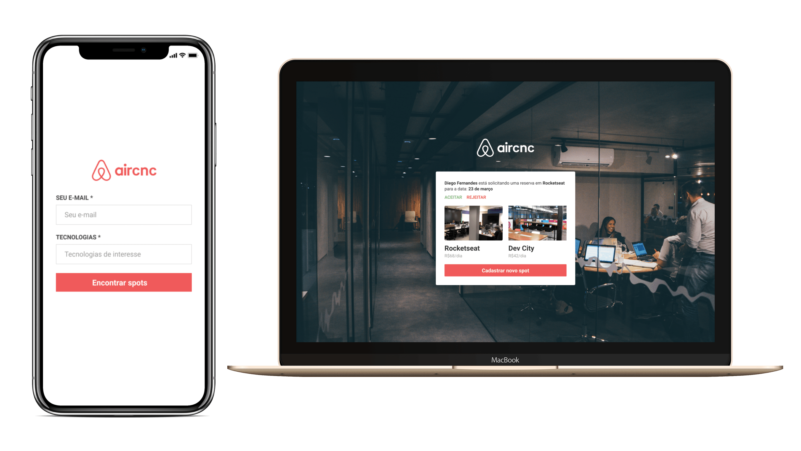

<h1 align="center">
  <br>
  <b>aircnc: code and coffee</b> ☕
</h1>

<p align="center">
  
  
  
  
  
  
</p>

<p align="center">
  <a href="#rocket-technologies">Technologies</a>&nbsp;&nbsp;&nbsp;|&nbsp;&nbsp;&nbsp;
  <a href="#computer-project">Project</a>&nbsp;&nbsp;&nbsp;|&nbsp;&nbsp;&nbsp;
  <a href="#bookmark-layout">Layout</a>&nbsp;&nbsp;&nbsp;|&nbsp;&nbsp;&nbsp;
  <a href="#seat-getting-started">Getting started</a>&nbsp;&nbsp;&nbsp;|&nbsp;&nbsp;&nbsp;
  <a href="#thinking-how-to-contribute">How to contribute</a>&nbsp;&nbsp;&nbsp;|&nbsp;&nbsp;&nbsp;
  <a href="#memo-license">License</a>
</p>

<br>

<p align="center">
  
</p>

## :rocket: Technologies

This project was developed with the following technologies:

- [Node.js](https://nodejs.org)
- [React](https://reactjs.org)
- [React Native](https://reactnative.dev)

Extras:

- Main Libs
  - [Express](https://expressjs.com)
  - [Mongoose ODM](https://mongoosejs.com)
  - [Next.js](https://nextjs.org)
  - [Expo](https://expo.io)
- Style
  - [EditorConfig](https://editorconfig.org)
  - [ESLint](https://eslint.org)
  - [Prettier](https://prettier.io)

## :computer: Project

**Aircnc** is a project that aims to connect companies that want to open spots and developers looking for a place to exchange ideas with devs, get to know the company and work there for a period.

## :bookmark: Layout

You can download the project layout in `.sketch` format through [this link](docs/assets/aircnc.sketch).

To open the file in `.sketch` format on any operating system use the tool [Zeplin](https://zeplin.io).

## :seat: Getting started

These instructions will get you a copy of the full project up and running on your local machine for development and testing purposes.

### API and Web App

You can view this project immediately at [https://diegomais-aircnc.netlify.app](https://diegomais-aircnc.netlify.app).

#### Setting up the development environment

For Docker Compose, install [Git](https://git-scm.com) and [Docker](https://www.docker.com). For local development, install [Node.js 24](https://nodejs.org/en/download/) and [pnpm 12](https://pnpm.io/installation), then install dependencies from the repository root:

```bash
pnpm install
```

#### Installation using Docker Compose

The following steps need to be performed inside a terminal window (Windows user may prefer to use the [Windows Terminal](https://aka.ms/windowsterminal) but the Command Prompt will also work).

Clone the repository and build Docker images:

```bash
git clone https://github.com/diegomais/aircnc.git
cd aircnc
docker-compose build
```

#### Running the services

Use the following command to run all aircnc containers (from within the aircnc directory):

```bash
docker-compose up
```

You can now use the API at [http://localhost:3333](http://localhost:3333) and view the Web App in the browser at [http://localhost:3000](http://localhost:3000).

### Mobile

With an Android phone, you can load this project immediately at [https://expo.io/@diegomais/aircnc](https://expo.io/@diegomais/aircnc).

The [Expo CLI](https://docs.expo.dev/more/expo-cli/) is included in the `expo` dependency declared by the mobile app. It is installed with `pnpm install`, so no global Expo CLI installation is needed.

#### Running the applications

Run each command from the repository root:

```bash
# API
pnpm --filter aircnc-backend dev

# Web app
pnpm --filter aircnc-frontend dev

# Mobile app
pnpm --filter ./apps/mobile start
```

For the mobile app, use `pnpm --filter ./apps/mobile android` or `pnpm --filter ./apps/mobile ios` to launch on a device or emulator.

## :thinking: How to contribute

- Fork this repository;
- Create a branch with your feature: `git checkout -b my-feature`;
- Commit your changes: `git commit -m '[feat](scope) My new feature'`;
- Push to your branch: `git push origin my-feature`.

After the merge of your pull request is done, you can delete your branch.

## :memo: License

This project is under the MIT license. See the [LICENSE](LICENSE) for more details.

---

Made with :heart: by [Diego Mais](https://diegomais.github.io/) :wave:.
